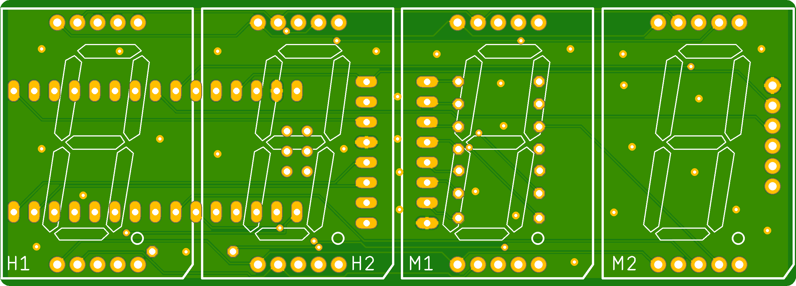
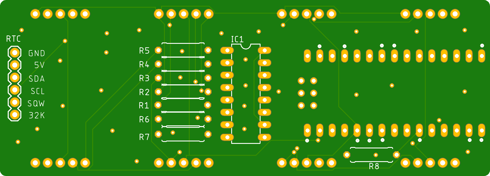

## Clock

A clock using Four, 1 inch 7 segment displays and One Shift register. Runs with an arduino Nano. 
Powered by a 5V adapter and USB Mini B cable. Uses a DS3231 RTC. 

[Credits to korolg for the Idea and Code](http://fritzing.org/projects/7-segment-led-clock-with-multiplexing)


 
 

## Programming (Updated Spetember 2025)

Will require the following libraries for the code to build on Android IDE 1.8.8

1. Install [Adafruit Bus IO](https://github.com/adafruit/Adafruit_BusIO)
2. Install [RTCLib by Adafruit](https://github.com/adafruit/RTClib)

## IDE Settings 

IDE settings for flashing the Arudino IDE 1.8.8 (which were used at the time the HW was built).
I haven't tried the Newer adruinos as the same HW has been running for ~6 years 

```
Board: Arduino Nano
Processor: ATMega328P (Old Bootloader)
Port: As per system device enumeration
Programmer: AVRISP mkII
```
