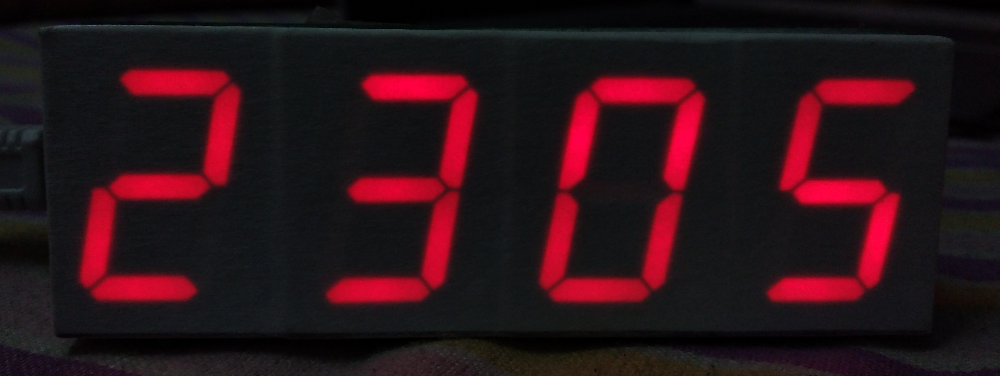

## Clock

A clock using Four, 1 inch 7 segment displays and One Shift register. Runs with an arduino Nano. 
Powered by a 5V adapter and USB Mini B cable. Uses a DS3231 RTC. 

[Credits to korolg for the Idea and Code](http://fritzing.org/projects/7-segment-led-clock-with-multiplexing)


 
 

## Programming (Updated Spetember 2025)

Will require the following libraries for the code to build on Android IDE 1.8.8

1. Install [Adafruit Bus IO](https://github.com/adafruit/Adafruit_BusIO)
2. Install [RTCLib by Adafruit](https://github.com/adafruit/RTClib)

## IDE Settings 

IDE settings for flashing the Arudino IDE 1.8.8 (which were used at the time the HW was built).
I haven't tried the Newer adruinos as the same HW has been running for ~6 years 

```
Board: Arduino Nano
Processor: ATMega328P (Old Bootloader)
Port: As per system device enumeration
Programmer: AVRISP mkII
```

## Setting the time over Bluetooth

The clock can be set from a phone with a small BLE module glued to the back of the board, so it never needs to be reflashed to change the time.

**Sync page:** [https://b-ak.github.io/fluffy-engine/clk/](https://b-ak.github.io/fluffy-engine/clk/)

Open it, tap **Sync clock to this time**, pick the clock from the list, and the clock is set to the phone's date and time. **Check clock time** shows what the clock reads and how far off it is.

The page works in Chrome on Android and desktop, and in the Bluefy browser on iPhone (Safari has no Web Bluetooth). Don't pair the module in the phone's Bluetooth settings; the page connects to it directly.

### Sketches

| Sketch | Use |
|---|---|
| `code/seven_segment_mux_clock_basic.ino` | Original clock, no Bluetooth. Time is set by reflashing. |
| `code/seven_segment_mux_clock_ble/` | Clock with Bluetooth time setting. Flash this once the module is fitted. |
| `code/ble_at_passthrough/` | One-time helper to send AT commands to the module (e.g. to name it). |

The Bluetooth sketches also use `SoftwareSerial`, which comes with the Arduino IDE. IDE settings are the same as above.

### Parts

- One HM-10 style BLE breakout per clock: **AT-09**, **HM-10** or **MLT-BT05** (CC2541), 6 pins (STATE, RXD, TXD, GND, VCC, EN/BRK). Use the breakout board with its own 3.3V regulator, not the bare module.
- **1kΩ** and **2kΩ** resistors (two 1kΩ in series, or 10kΩ/20kΩ, work too)
- Optional: a **10–100µF** capacitor across the module's VCC and GND

### Wiring

The module talks to the Nano over `SoftwareSerial` on **D8/D10**. D0/D1 are not used for it, since D1 drives the first hour digit. D8 and D10 are not connected to anything else on the board.

| Module pin | Nano pin | Notes |
|---|---|---|
| VCC | 5V | Same net as the RTC and 74HC595 supply. The module's regulator drops it to 3.3V. |
| GND | GND | |
| TXD | D8 | 3.3V output, read fine by the Nano. |
| RXD | D10, through the divider | The module's input is 3.3V, so don't connect 5V directly. |
| STATE | not connected | |
| EN / BRK | not connected | |

Divider on the D10 line (5V x 2/3 = 3.3V):

```
Nano D10 ──[ 1kΩ ]──┬──► module RXD
                    │
                  [ 2kΩ ]
                    │
                   GND
```

Check the pin labels on the module you receive; some clones order them differently.

### Mounting

- Put **Kapton tape or double-sided foam tape** between the module and the back of the board, so the module's traces can't touch the through-hole leads. Foam tape also keeps it removable.
- Leave the **antenna end** (the zig-zag trace) hanging past the board edge, or at least away from the Nano, the RTC and large copper areas.
- Solder the wires straight to the Nano's pins on the back. The two resistors can sit inline in the wires under heat-shrink.

### One-time setup: name each clock

With two clocks, give each module its own name so they can be told apart in the phone's list. Names starting with `CLK` are listed by the sync page without ticking "Show all Bluetooth devices".

1. Flash `code/ble_at_passthrough/` to the Nano. The first hour digit flickers while it runs; that's expected.
2. Open the Serial Monitor at **9600 baud**. Make sure no phone is connected to the module (AT commands only work while it is disconnected).
3. Type `AT` and send. The module should reply `OK`. If nothing comes back, change the line ending setting: AT-09 / MLT-BT05 clones usually need **Both NL & CR**, a genuine HM-10 usually needs **No line ending**.
4. Send `AT+NAMECLK-Hall` (or `CLK-Bedroom`, up to 12 characters), then `AT+RESET`.
5. Flash `code/seven_segment_mux_clock_ble/` back to the Nano.

Leave the baud rate and the service/characteristic UUIDs at their defaults (9600, FFE0/FFE1); the sketch and the page expect them.

### Protocol

For reference or for use from another app. 9600 baud, one command per line (`\n` or `\r` ends it):

| Command | Meaning | Reply |
|---|---|---|
| `TYYYYMMDDhhmmss` | Set date and time, e.g. `T20261123235000` | `OK 2026-11-23 23:50:00` (read back from the RTC), or `ERR` |
| `?` | Read the clock | `NOW 2026-11-23 23:50:00` |

Each command is at most 16 bytes, so it fits a single 20-byte BLE write. The sketch never adjusts the RTC at boot, so a power cut can't reset the time.

### Troubleshooting

- **Clock not in the list:** tick "Show all Bluetooth devices", or name the module as above. Only one phone can be connected at a time.
- **"The clock didn't answer":** check that the clock runs `seven_segment_mux_clock_ble`, that module TXD goes to D8, and the D10 divider to module RXD. If only the D10 side is broken, the time is still set but the reply never reaches the phone; "Check clock time" will also get no answer.
- **Brief flicker while syncing:** `SoftwareSerial` pauses the display for a few milliseconds while a command arrives. It only happens during a sync.
