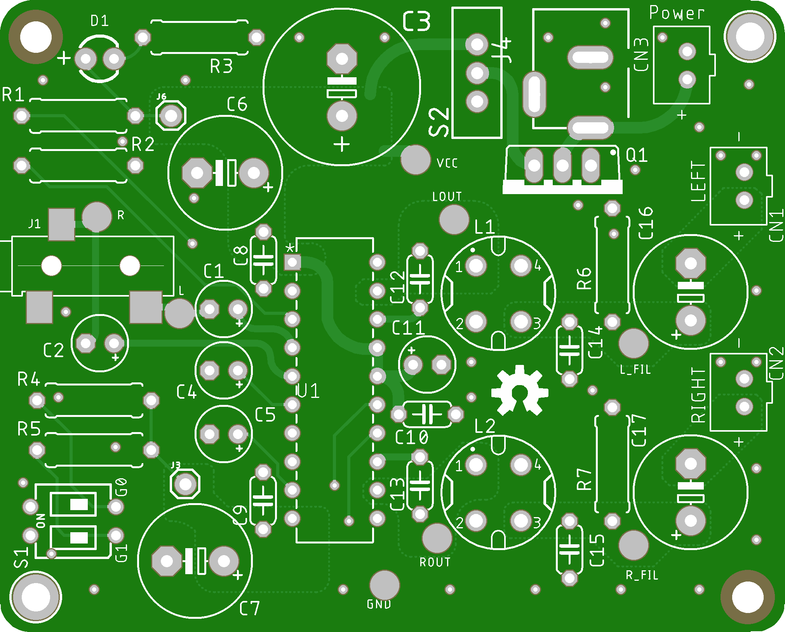
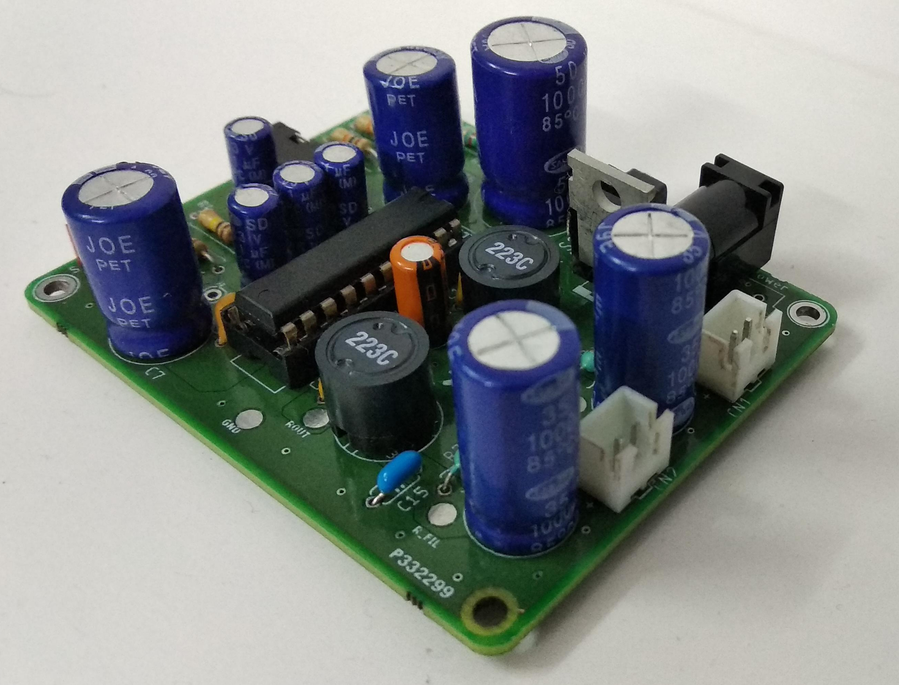

# Hardware Experiments

## 1. _Class D amplifier_    

Unpolulated Board   
   

Populated Board   

## 2. _A dumb Clock_    

Now in its own repository: **[b-ak/dusty-clock](https://github.com/b-ak/dusty-clock)**   
 
Preview   
   

PCB   
   

